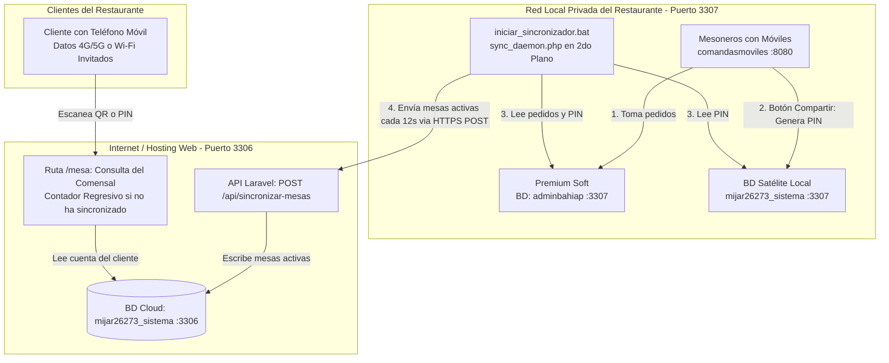
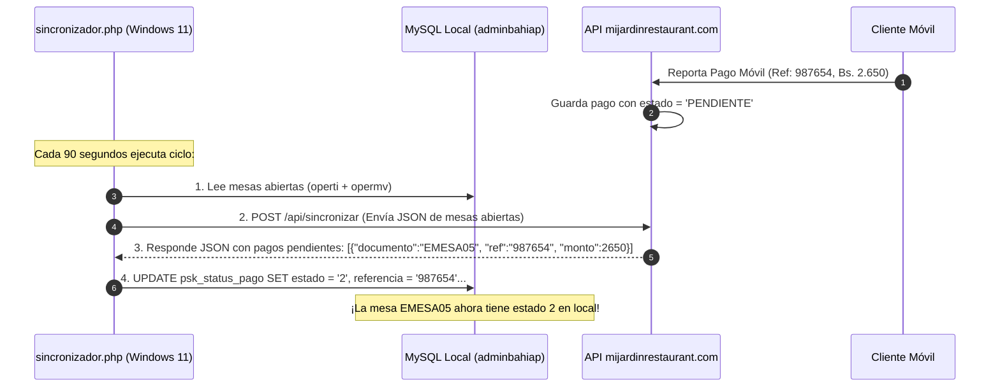
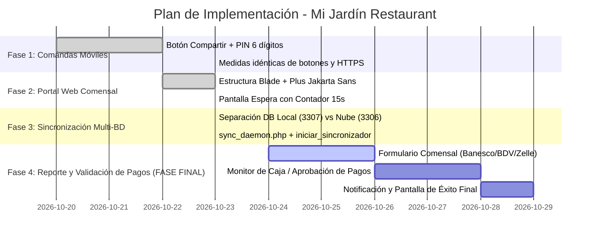

# Estudio de Factibilidad Técnica: Módulo de Cuenta por QR, Reporte de Pagos y Menú Web Seguro

**Proyecto:** pskmovil  
**Fecha de Actualización:** 23 de Octubre de 2026  
**Documento:** Propuesta Técnica de Arquitectura Híbrida (Local + Cloud)  

---

## 1. Diagnóstico de Seguridad y Red Local

### 1.1. Riesgos de una Red Plana Compartida
En la propuesta inicial, exponer el servidor local (PC con Windows 11, puerto 2010/8080 y MySQL 3306/3307) a la misma red Wi-Fi donde se conectan los clientes presenta riesgos críticos:
- **Escaneo de Puertos y Vulnerabilidades:** Un comensal o persona en las adyacencias puede escanear la red con herramientas como Nmap o Fing y atacar servicios de Windows (SMB puerto 445, RDP 3389, o MySQL 3306).
- **Ataques DoS:** Saturar el servidor Apache local y paralizar la toma de comandas de los mesoneros en plena hora pico.

### 1.2. Reglas de Protección Físicas y Firewall

#### A. Segmentación Wi-Fi en el Router
1. **Wi-Fi Privada (`Restaurante_Interno`):** Exclusiva para el Servidor (`192.168.1.100`), la PC de la Administradora (`192.168.1.101`) y los dispositivos móviles de los mesoneros. Esta contraseña **nunca se comparte con clientes**.
2. **Wi-Fi Clientes (`Restaurante_Invitados`):** Para los clientes que soliciten internet.
   - **Aislamiento de Clientes (AP Isolation):** Activado (los dispositivos de los clientes no pueden comunicarse entre sí).
   - **Bloqueo a Red Local (LAN Isolation):** Activado (el router les da salida a Internet pero bloquea cualquier intento de acceder al rango `192.168.1.X`).

#### B. Regla Estricta para MySQL (Puerto 3306)
- Dado que solo dos computadoras interactúan con la base de datos de Premium Soft:
  - **Servidor Local:** `192.168.1.100` (`localhost` / `127.0.0.1`)
  - **Administradora:** `192.168.1.101`
- En el **Firewall de Windows Defender** del Servidor:
  - Se crea una regla de entrada en el puerto TCP `3306` con ámbito restringido (**Scope**): **Únicamente permitir la IP `192.168.1.101` y `127.0.0.1`**. Cualquier otra IP es rechazada de inmediato a nivel de red.
- En MySQL:
  ```sql
  -- Usuario administrativo exclusivo desde la IP de la administradora
  GRANT ALL ON adminbahiap.* TO 'admin_bahia'@'192.168.1.101' IDENTIFIED BY 'ClaveRobusta2026!';
  FLUSH PRIVILEGES;
  ```

---

## 2. Arquitectura Híbrida: Servidor Local Windows (3307) + Hosting Web (3306)

Para garantizar que los clientes **nunca toquen la red local**, la interacción con comensales se traslada a un hosting en internet con dominio propio (`mijardinrestaurant.com` / `mijardinrestaurant.test`) desarrollado en **Laravel + Blade**.

### 2.1. Separación Estricta de Bases de Datos
1. **Entorno Local (Puerto 3307 - PC Restaurante):**
   - **`adminbahiap`:** Base de datos principal de Premium Soft (tablas vírgenes: `operti`, `opermv`, etc.).
   - **`mijar26273_sistema` (Local):** Base de datos satélite que almacena el PIN generado por el mesonero en `z_status_pago` y copia local en `z_mesas_activas`.
2. **Entorno Nube / Remoto (Puerto 3306 - Hosting Web):**
   - **`mijar26273_sistema` (Nube):** Base de datos que alimenta el portal web del cliente (`mijardinrestaurant.com` / `mijardinrestaurant.test`).
   - Solo recibe datos mediante peticiones salientes seguras (**HTTPS POST Outbound**) emitidas por el demonio local `sync_daemon.php`.



---

## 3. Experiencia de Usuario: Token Dinámico y Contador Regresivo

### 3.1. Dos Métodos de Acceso para el Cliente
1. **Acceso Automático por QR:**
   - El mesonero presiona "Compartir" en su teléfono.
   - El QR contiene la URL segura con el PIN: `https://mijardinrestaurant.com/mesa?t=339109`.
   - Al escanearlo, el cliente entra directamente a su cuenta sin tener que escribir nada.
2. **Acceso Manual por PIN:**
   - Si el cliente no escanea el QR, ingresa directamente a `https://mijardinrestaurant.com/mesa`.
   - La pantalla le solicita el **PIN de 6 dígitos** (ej: `339109`), el cual se lo dicta el mesonero o lo ve en la comanda.

### 3.2. Pantalla de Espera Dinámica (Contador Regresivo de 15 Segundos)
Si el cliente abre el enlace o introduce el código antes de que `sync_daemon.php` haya enviado la mesa a la nube:
- **No se muestra error de "Token no encontrado".**
- Se presenta una pantalla de espera moderna con un **contador regresivo animado**:
  - *"Estamos preparando el detalle de tu mesa... Próxima comprobación en 15s..."*
  - Barra de progreso interactiva y spinner azul corporativo (`#0880C5`).
  - El navegador realiza consultas automáticas cada 3-4 segundos (`fetch /mesa/estado-ajax`).
  - En cuanto el demonio local deposita los datos en la nube, la pantalla se recarga automáticamente y despliega los artículos consumidos de forma inmediata.

---

## 4. Base de Datos: Respeto Total a Premium Soft (`adminbahiap`)

### 4.1. Principio Fundamental
**No se altera ni se agrega ninguna columna a las tablas nativas de Premium Soft.**
El sistema lee de forma directa y limpia las tablas existentes:
- **`operti`:** Encabezado de la mesa activa (`documento = 'EMESA05'`, `tipodoc = 'ESP'`).
- **`opermv`:** Artículos cargados en la mesa (`fechayhora`, `cantidad`, `codigo`, `nombre`, `preciounit`, `montoneto`).
- **`grupos`:** Categorías de comida y bebidas (`codigo`, `nombre`, `rutafoto`, `oculto_restaurant`).
- **`articulos`:** Menú completo (`codigo`, `nombre`, `precio1`, `rutafoto`, `grupo`).
- **`usuarios` / `listvend`:** Autenticación de vendedores y cajeros (eliminando la clave fija `PeDrO` de `datos_conexion.json`).

### 4.2. Tabla Satélite Intermediaria Local: `psk_status_pago`
Para rastrear el estado del pago reportado por el cliente sin tocar Premium Soft, se crea una única tabla auxiliar ligera en la base de datos local:

```sql
CREATE TABLE IF NOT EXISTS psk_status_pago (
    id INT AUTO_INCREMENT PRIMARY KEY,
    documento VARCHAR(20) NOT NULL UNIQUE, -- Ej: 'EMESA05'
    token_pin VARCHAR(10) NOT NULL,        -- Ej: '482910'
    estado ENUM('0', '2', '1') DEFAULT '0', -- 0: En consumo / No pagado
                                           -- 2: En confirmación (AZUL)
                                           -- 1: Pagado y Verificado (VERDE)
    metodo VARCHAR(30) NULL,               -- Pago Móvil / Zelle / Transferencia
    banco_origen VARCHAR(50) NULL,
    referencia VARCHAR(30) NULL,
    monto DECIMAL(14,2) DEFAULT 0.00,
    moneda VARCHAR(5) DEFAULT 'VES',
    fecha_reporte DATETIME NULL,
    aprobado_por VARCHAR(50) NULL,
    fecha_confirmacion DATETIME NULL,
    INDEX idx_doc (documento),
    INDEX idx_pin (token_pin)
) ENGINE=InnoDB DEFAULT CHARSET=utf8mb4;
```

---

## 5. Mecanismo de Sincronización Bidireccional (PC Windows ↔ Hosting Web)

### 5.1. ¿Cómo extrae `comandasmoviles` la información del Hosting?
La PC del restaurante **no abre puertos para recibir conexiones externas**. Todo se resuelve mediante peticiones salientes seguras (Outbound HTTPS):



### 5.2. Código de Colores en `comandasmoviles`
Al listar o consultar las mesas en tránsito dentro de `comandasmoviles`:
- **Color Estándar (Blanco/Gris):** `estado = 0` (Sin reporte de pago, comensales consumiendo activamente).
- **Color AZUL:** `estado = 2` (El cliente ya reportó el pago móvil; espera que la caja o administradora verifique la cuenta bancaria).
- **Color VERDE:** `estado = 1` (La administradora o caja verificó el pago y presionó "Confirmar").

---

## 6. Sincronización Continua: `sync_daemon.php` e `iniciar_sincronizador.bat`

El proceso local de sincronización se ejecuta mediante [sync_daemon.php](file:///e:/herd/comandasmoviles/sync_daemon.php) con lanzador directo [iniciar_sincronizador.bat](file:///e:/herd/comandasmoviles/iniciar_sincronizador.bat):

1. **Lectura Local (Puerto 3307):**
   - Consulta las mesas abiertas en `adminbahiap.operti` (`tipodoc = 'ESP'`).
   - Obtiene los platos y montos desde `adminbahiap.opermv`.
   - Consulta o genera el PIN en `mijar26273_sistema.z_status_pago`.
   - Actualiza la copia local en `mijar26273_sistema.z_mesas_activas`.
2. **Transmisión Segura Outbound (HTTPS):**
   - Emite un `POST https://mijardinrestaurant.test/api/sincronizar-mesas`.
   - La base de datos de la nube (`mijar26273_sistema` en puerto 3306) actualiza sus registros de comensal.
   - En caso de mesas cerradas o facturadas, las archiva como inactivas.

```bat
@echo off
title Sincronizador Cloud - Mi Jardin Restaurant
cd /d "%~dp0"
echo ========================================================
echo     SINCRONIZADOR CLOUD - MI JARDIN RESTAURANT
echo        (MYSQL PUERTO 3307 LOCAL -> NUBE HTTPS)
echo ========================================================
echo.
php sync_daemon.php
pause
```

---

## 7. Hoja de Ruta y Organización por Fases



### Detalle de Fases:
* **Fase 1 (Completada):** Botón «Compartir» en Comandas Móviles con medidas equivalentes a Procesar y Comanda, generación de PIN de 6 dígitos y modal de QR con protocolo HTTPS.
* **Fase 2 (Completada):** Portal web del comensal en Laravel + Blade, pantalla de consulta por PIN y pantalla de espera con contador regresivo de 15 segundos animado.
* **Fase 3 (Completada):** Separación de entornos de base de datos (`adminbahiap` y `mijar26273_sistema` en puerto 3307 local vs `mijar26273_sistema` en puerto 3306 nube) y demonio de sincronización automática `sync_daemon.php` con archivo `.bat`.
* **Fase 4 (Fase Final - Pagos):** Recepción de pagos móviles y transferencias reportadas por el comensal, validación en caja/supervisor y confirmación inmediata en la pantalla del cliente.
