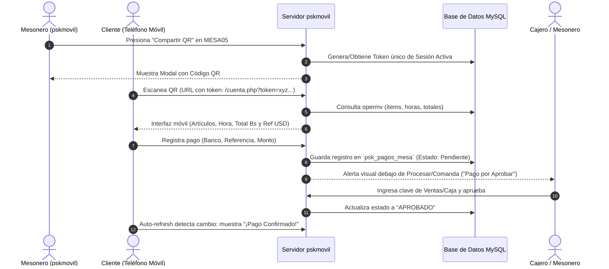

# Estudio de Factibilidad Técnica: Módulo de Cuenta por QR y Reporte de Pagos

**Proyecto:** pskmovil  
**Fecha:** 22 de Octubre de 2026  
**Documento:** Propuesta Técnica y Análisis de Base de Datos  

---

## 1. Resumen del Objetivo

Permitir que, una vez que el mesonero cargue los productos en una mesa activa (ejemplo: `MESA05`), se disponga de un botón **Compartir** que genere un código **QR dinámico**. 

Al ser escaneado por el cliente desde su propio teléfono inteligente:
1. **Vista de Cuenta en Tiempo Real (Solo Lectura):** El cliente visualiza los artículos ordenados con su **hora**, **cantidad**, **descripción** y **total**, junto al monto final en Bs. y Divisas (Tasa del día).
2. **Reporte de Pago (Pago Móvil / Transferencia):** El cliente visualiza los datos bancarios del establecimiento y puede registrar el comprobante (método, banco emisor, referencia y monto).
3. **Panel de Verificación y Aprobación:** En el sistema web (`pskmovil`), los mesoneros y la caja reciben una alerta visual de "Pago por Aprobar". Con la clave autorizada (cajero/ventas), se aprueba el pago.
4. **Confirmación Inmediata al Cliente:** El dispositivo del cliente actualiza su estado a **"Pago Confirmado"**.
5. **Seguridad y Aislamiento por Sesión:** El QR utiliza un token único aleatorio. Al cerrarse la mesa o iniciar una nueva cuenta, el token expira para proteger la privacidad de consumos posteriores.

---

## 2. Análisis del Código y Base de Datos Existente

### 2.1. ¿Se guarda la hora en que se incluyen los artículos?
**SÍ, completamente.**
- En la tabla de movimientos de cuenta activa (`opermv`), existe el campo **`fechayhora`** de tipo `datetime` (ejemplo: `2026-10-22 19:35:10`), que se registra automáticamente en cada inserción a través de `controladores/controlador_pedidos.php`.
- También se cuenta con `fechadoc` (`date`) y `fechadocant`.
- **Conclusión:** Es 100% viable extraer la hora formateada (`H:i` o `h:i A`) de cada ítem pedido para mostrarla en la comanda del cliente:
  ```sql
  SELECT DATE_FORMAT(fechayhora, '%h:%i %p') AS hora, cantidad, nombre, preciounit, preciofin, montoneto
  FROM opermv
  WHERE documento = 'EMESA05' AND tipodoc = 'ESP'
  ORDER BY fechayhora ASC;
  ```

### 2.2. ¿Cómo se gestionan los usuarios y contraseñas?
- En el sistema tradicional de escritorio (heredado de Premium Soft), la tabla `usuarios` no almacena contraseñas en texto plano para los cajeros en terminales móviles.
- **La tabla operativa de ventas/caja es `listvend`:**
  - Columnas: `codigo`, `nombre`, `claverest`.
  - El campo **`claverest`** (varchar(8)) es la clave de restaurante configurada para cada vendedor/cajero (validada en `controladores/controlador_vendedores.php` durante el login).
- Adicionalmente, el sistema web maneja en `datos_conexion.json` la clave maestra de supervisor:
  - `"pw_supervisor": "123"` (validada en `funciones/permisos_adm.php`).
- **Conclusión:** Para la aprobación del pago, se puede autorizar con la **`claverest` del usuario "Caja" o "Ventas"** (o en su defecto con la clave de supervisor).

### 2.3. Estructura de Bancos existente (`bancotab`)
- La tabla `bancotab` existente contiene únicamente:
  - `id_empresa`, `agencia`, `codigo`, `nombre` (ej. "BANCO GENÉRICO", "BIOPAGO", "CUENTA ZELLE", "PAGO MOVIL"), `inactivo`.
- **Limitación identificada:** No posee campos para número de cuenta de 20 dígitos, cédula/RIF del titular ni teléfono para Pago Móvil.
- **Solución recomendada:** Crear una pequeña tabla de configuración bancaria (`psk_cuentas_receptoras`) o un archivo JSON de configuración con los datos que se presentarán al cliente para pagar.

---

## 3. Arquitectura de la Solución Propuesta



---

## 4. Diseño de Base de Datos Necesario

Para no alterar las tablas nativas de Premium Soft (`operti`, `opermv`, etc.) y garantizar total estabilidad del sistema, se propone la creación de dos tablas satélite ligeras:

### 4.1. Tabla: `psk_sesiones_qr`
Garantiza que el enlace sea **único y efímero** para cada grupo de clientes que ocupa la mesa.

| Campo | Tipo | Descripción |
|---|---|---|
| `id` | INT AUTO_INCREMENT PRIMARY KEY | Identificador único |
| `mesa` | VARCHAR(20) | Identificador de mesa (ej. `MESA05`) |
| `token` | VARCHAR(64) UNIQUE | Hash aleatorio criptográfico (ej. `bin2hex(random_bytes(16))`) |
| `fecha_apertura` | DATETIME | Momento en que se generó la sesión |
| `estado` | ENUM('ACTIVA', 'CERRADA') | Estado de la sesión |

> **Mecanismo de Caducidad:** Cuando la mesa es procesada o liberada en el sistema, la sesión pasa a `CERRADA`. Si un cliente anterior vuelve a abrir el enlace después de retirarse, el sistema le indica: *"Esta cuenta ya ha sido cerrada. ¡Gracias por su visita!"*, impidiendo ver pedidos de nuevos comensales.

### 4.2. Tabla: `psk_pagos_mesa`
Almacena el reporte del pago enviado por el cliente.

| Campo | Tipo | Descripción |
|---|---|---|
| `id` | INT AUTO_INCREMENT PRIMARY KEY | ID de pago |
| `sesion_token` | VARCHAR(64) | Enlace con la sesión QR |
| `mesa` | VARCHAR(20) | Código de la mesa |
| `metodo` | VARCHAR(30) | Pago Móvil / Transferencia / Zelle |
| `banco_origen` | VARCHAR(50) | Banco desde donde pagó el cliente |
| `referencia` | VARCHAR(20) | Número de referencia de la transacción |
| `monto` | DECIMAL(14,2) | Monto reportado por el cliente |
| `moneda` | VARCHAR(5) | `VES` o `USD` |
| `estado` | ENUM('PENDIENTE','APROBADO','RECHAZADO') | Estado de aprobación |
| `fecha_reporte` | DATETIME | Momento en que el cliente envió el reporte |
| `aprobado_por` | VARCHAR(50) NULL | Código/Nombre de quien aprobó |
| `fecha_aprobacion` | DATETIME NULL | Fecha y hora de confirmación |

---

## 5. Módulos y Componentes a Desarrollar

### 5.1. Botón "Compartir" y Modal de QR en `index.php`
- Al lado o debajo de los botones **Procesar** y **Comanda**, agregar el botón `<button class="btn btn-info" id="btn_compartir_qr"><i class="fa fa-qrcode"></i> Compartir Cuenta</button>`.
- Solo se activa si la mesa tiene artículos cargados (`productos_array.length > 0`).
- Al hacer clic, abre un modal elegante mostrando el código QR generado (usando la librería ligera `qrcode.min.js` en cliente, sin dependencias de internet).
- Incluye botón para copiar el enlace directo si el mesonero prefiere enviarlo por WhatsApp.

### 5.2. Vista Pública de Cliente (`vistas/cliente_cuenta.php`)
- Página web responsiva, optimizada para pantallas móviles de cualquier gama.
- **Cabecera:** Nombre y Logo de la empresa, Mesa (`MESA05`), Fecha y Nombre del Mesonero.
- **Tabla de Consumo:**
  - Columnas: **Hora** (`H:i A`), **Cant.**, **Producto**, **Total**.
- **Resumen Financiero:**
  - Subtotal.
  - Impuestos / Recargos.
  - **TOTAL EN BOLÍVARES (Bs.)**.
  - **TOTAL EN DÓLARES (REF. USD)** calculado con la tasa del día.
- **Datos de Pago:**
  - Sección desplegable con los datos para realizar Pago Móvil o Transferencia (Banco, RIF, Teléfono, Número de Cuenta).
- **Formulario de Notificación de Pago:**
  - Selector de método de pago.
  - Campo de número de referencia bancaria.
  - Campo de monto pagado.
  - Botón: "Reportar Pago Realizado".
- **Monitor de Estado:**
  - Mediante sondeo asíncrono (polling AJAX cada 4 segundos), cuando la caja apruebe el pago, la pantalla del cliente cambia automáticamente a un banner verde de felicitación: **"¡Pago Aprobado y Confirmado!"**.

### 5.3. Sección de Alerta y Aprobación en la Pantalla de Pedidos
- Debajo de los botones **Procesar** y **Comanda**:
  - Un contenedor dinámico `#alerta_pago_cliente`:
    - Si hay un pago pendiente para la mesa seleccionada, se muestra una tarjeta destacada (fondo amarillo/naranja con borde parpadeante sutil):
      - *«Pago Móvil Reportado: Ref. 123456 - Bs. 2.643,38»*
      - Botón verde: **Aprobar Pago**.
- Al presionar **Aprobar Pago**:
  - Se despliega el modal solicitando la clave del usuario de Ventas/Caja (`claverest` en `listvend` o clave de supervisor).
  - Al validar la clave, el pago pasa a `APROBADO`.

---

## 6. Estimación de Tiempos de Implementación

| Fase | Tareas | Tiempo Estimado |
|---|---|---|
| **Fase 1: Base de Datos y Sesiones QR** | Creación de tablas `psk_sesiones_qr` y `psk_pagos_mesa`. Endpoint backend para generar/validar tokens efímeros. Integración de generador QR en `index.php`. | **6 a 8 horas** |
| **Fase 2: Vista Pública del Cliente** | Diseño responsivo de la interfaz web del cliente (`cliente_cuenta.php`). Consulta de ítems con fecha/hora de `opermv`. Resumen de montos y desglose de tasa. | **8 a 10 horas** |
| **Fase 3: Formulario de Pago y Cuentas Bancarias** | Módulo de configuración de datos bancarios. Formulario para reporte de pago móvil/transferencia por parte del cliente. | **4 a 6 horas** |
| **Fase 4: Panel de Aprobación en `pskmovil`** | Detección en tiempo real del pago en la mesa. Modal de validación de clave con `listvend.claverest`. Cambio de estado en tiempo real para el cliente. | **6 a 8 horas** |
| **Fase 5: Pruebas, Seguridad y Caducidad de Tokens** | Validación de caducidad al cerrar la mesa, pruebas en redes WiFi/IP local, control de concurrencia y validación de referencias bancarias. | **4 a 6 horas** |
| **TOTAL ESTIMADO** | **Proyecto Completo** | **28 a 38 horas** *(aprox. 4 a 6 días de trabajo continuo)* |

---

## 7. Conclusión y Recomendación

La implementación es **100% viable técnicamente**:
1. La base de datos actual ya guarda la **hora exacta de los artículos** en `opermv.fechayhora`.
2. Las claves de acceso de los cajeros/vendedores están disponibles en `listvend.claverest`.
3. El uso de tokens aleatorios resuelve completamente el requisito de privacidad para que clientes posteriores no accedan a consumos ajenos.
4. No se alteran las tablas contables maestras de Premium Soft, garantizando que el sistema principal de escritorio siga funcionando sin ninguna discrepancia.
